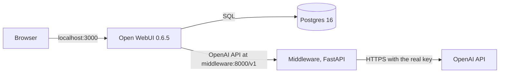

# Open WebUI with a system-prompt middleware

## What this is

This repository starts three services with one command: Open WebUI 0.6.5, a Postgres database that Open WebUI uses for persistence, and a small FastAPI middleware. Open WebUI talks to the middleware as if it were the OpenAI API, and the middleware puts a system prompt in front of every chat before forwarding it to OpenAI with the real key and streaming the answer back. The system prompt, documented in [SYSTEM_PROMPT.md](SYSTEM_PROMPT.md), turns GPT into a structured data extractor.

## Architecture



What happens to one chat message:

1. Open WebUI sends `POST /v1/chat/completions` to the middleware, usually with `stream: true`.
2. The middleware validates the body and logs a summary of it, without message text.
3. It puts the system prompt first in `messages`, unless the request is one of Open WebUI's background title or tag calls.
4. It forwards the body to OpenAI with its own key, retrying connection errors, timeouts and 5xx responses until the first byte reaches the client.
5. It relays OpenAI's answer back as it arrives, then logs how long it took.

Only the middleware container has the OpenAI key. Open WebUI's "OpenAI key" is `MIDDLEWARE_API_KEY`, which the middleware checks if it is set.

| File | Responsibility |
|---|---|
| `middleware/app/main.py` | App factory, lifespan, error handler, request lifecycle logging |
| `middleware/app/config.py` | Settings from environment variables |
| `middleware/app/prompt.py` | Reads the prompt between the markers in `SYSTEM_PROMPT.md` |
| `middleware/app/injection.py` | Pure functions: insert the prompt, detect Open WebUI's background calls |
| `middleware/app/upstream.py` | HTTP client, forwarding, retries, streaming relay, error mapping, readiness probe |
| `middleware/app/logging.py` | JSON log formatter and the per-request ID |
| `middleware/app/auth.py` | Optional bearer token check |
| `middleware/app/routes/` | `/v1/chat/completions`, `/v1/models`, `/health`, `/ready` |

## Quickstart

You need Docker with Compose v2 and `make`. Python 3.11 or newer is only needed to run the tests outside Docker.

```bash
git clone https://github.com/isarinio22/open-webui-prompt-middleware.git
cd open-webui-prompt-middleware
cp .env.example .env
# Edit .env and set OPENAI_API_KEY.
make up
```

The first start downloads the Open WebUI image, which takes a few minutes. Open WebUI starts only after Postgres is healthy and the middleware reports ready, and the middleware is ready only once OpenAI accepts its key. A wrong key therefore shows up within a minute as an unhealthy middleware:

```bash
docker compose ps        # all three services should say "healthy"
make logs                # follow the middleware's JSON logs
make down                # stop everything; data is kept
docker compose down -v   # stop everything and delete the data volumes
```

Then open http://localhost:3000. The first account you create becomes the admin.

## Verify end to end

The middleware is published on localhost only, so these commands work from the machine running the stack.

```bash
curl -s localhost:8000/health
# {"status":"ok"}

curl -s localhost:8000/ready
# {"status":"ready"}

curl -s localhost:8000/v1/models
# {"object":"list","data":[{"id":"gpt-4o-mini","object":"model","created":0,"owned_by":"openai"},
#                          {"id":"gpt-4o","object":"model","created":0,"owned_by":"openai"}]}
```

A streamed completion. `-N` turns off curl's buffering, so the events print as they arrive:

```bash
curl -sN localhost:8000/v1/chat/completions \
  -H 'Content-Type: application/json' \
  -d '{"model": "gpt-4o-mini", "stream": true, "messages": [{"role": "user", "content": "Receipt: 2 coffees, 7.40 EUR, Cafe Lisboa, 2026-03-12"}]}'
```

The output is a series of `data:` events ending in `data: [DONE]`. Shortened:

```
data: {"id":"chatcmpl-...","object":"chat.completion.chunk",...,"choices":[{"index":0,"delta":{"content":"Document"},...}]}
...
data: [DONE]
```

If `MIDDLEWARE_API_KEY` is set, add `-H "Authorization: Bearer <that key>"` to the `/v1` calls.

In the browser:

1. Open http://localhost:3000 and sign in.
2. Pick `gpt-4o-mini` from the model list at the top.
3. Paste a receipt, an email or any other text. The answer starts with a `Document type:` line followed by a JSON block.
4. Ask a question about it, such as "What was the total?". The answer is plain prose and ends with a `Referenced fields:` line.
5. Check the chat's title in the sidebar. It should be a short readable title, not JSON, because the middleware does not add the extraction prompt to Open WebUI's title request.
6. In `make logs`, each request shows up as one group of lines with the same `request_id`.

## Configuration

All settings come from `.env`. [.env.example](.env.example) lists every variable with a one-line comment.

| Variable | Default | Purpose |
|---|---|---|
| `OPENAI_API_KEY` | required | The real OpenAI key. Only the middleware sees it. |
| `OPENAI_BASE_URL` | `https://api.openai.com/v1` | Where requests are forwarded. Can point at a mock or another OpenAI-compatible server. |
| `ALLOWED_MODELS` | `gpt-4o-mini,gpt-4o` | Comma-separated list that `/v1/models` advertises. |
| `SYSTEM_PROMPT_PATH` | `/app/SYSTEM_PROMPT.md` | Prompt file inside the container. The Dockerfile copies the repository's file there. |
| `MIDDLEWARE_API_KEY` | unset | If set, every `/v1` request must send it as a bearer token. Compose passes it to Open WebUI as its OpenAI key. |
| `INJECT_ON_INTERNAL_TASKS` | `false` | Also add the system prompt to Open WebUI's title and tag requests. |
| `UPSTREAM_CONNECT_TIMEOUT` | `10` | Seconds to open a connection to OpenAI. |
| `UPSTREAM_READ_TIMEOUT` | `60` | Seconds to wait for a response, or between two streamed chunks. |
| `UPSTREAM_MAX_RETRIES` | `2` | Extra attempts after a connection error, timeout or 5xx, before any byte reaches the client. |
| `LOG_LEVEL` | `INFO` | Python logging level. `DEBUG` also shows the health check requests. |
| `LOG_MESSAGE_CONTENT` | `false` | Log full chat messages. Off by default because users paste personal data. |
| `POSTGRES_USER`, `POSTGRES_PASSWORD`, `POSTGRES_DB` | `openwebui` | Database credentials, used by Postgres and in Open WebUI's `DATABASE_URL`. |
| `WEBUI_SECRET_KEY` | `change-me` | Signs Open WebUI's session tokens. |

The middleware refuses to start if `OPENAI_API_KEY` is missing or the prompt file can't be read or has no markers.

Open WebUI saves its OpenAI connection settings in the database on first start and ignores the environment after that. If you change `MIDDLEWARE_API_KEY` later, either update the connection in Open WebUI's admin settings or start fresh with `docker compose down -v`.

## Design decisions

- **Forward the request body unchanged except for `messages`.** A small pydantic schema checks that `model` and `messages` exist, but the original JSON is what gets forwarded. I rejected parsing the request into a full OpenAI schema and serializing it again: that drops any field the schema doesn't declare, adds defaults the client never sent, and needs an update every time OpenAI adds a parameter.
- **Our prompt goes first, and a client's own system message stays after it.** Open WebUI sends a system message when a user sets one in their settings. I rejected replacing it, which would throw away the user's context, and putting ours last, which would let any earlier instruction set the frame. The prompt itself says later system messages can't change the output format.
- **Skip injection on Open WebUI's title and tag calls.** With the extraction prompt, a title request returns a JSON block, and that JSON becomes the chat's name in the sidebar. Open WebUI labels these calls as tasks internally but deletes that label before calling OpenAI, which I confirmed in its source and in captured traffic. So the middleware detects them by their shape: not streamed, and the last user message starts with `### Task:`. I rejected turning off title generation in Open WebUI, which loses a feature, and injecting everywhere, which breaks titles. `INJECT_ON_INTERNAL_TASKS` turns injection back on for these calls.
- **One prompt file with markers.** `SYSTEM_PROMPT.md` holds both the prompt and its explanation, and the middleware reads only the text between `PROMPT:BEGIN` and `PROMPT:END`. I rejected keeping the prompt in an environment variable or a separate text file, because then the documented prompt and the running prompt can drift apart. A test loads the real file, so a broken marker fails CI instead of failing at container start.
- **The prompt is baked into the image.** I rejected a bind mount, which would let you edit the prompt without a rebuild, because then the image alone is not enough to know what the service does. Rebuilding takes seconds with `make up`.
- **Fixed output format instead of OpenAI's JSON mode.** I rejected `response_format` with a JSON schema. It would force JSON on every reply, but follow-up answers must be prose, and the format starts with a human-readable type line. It would also mean rewriting request fields the client sent.
- **Relay streamed bytes as they arrive.** The middleware passes OpenAI's server-sent events through without parsing them. I rejected parsing and re-emitting each event, which adds code and can change the framing, and the middleware never needs to read the answer.
- **Retry only before the first byte.** Connection errors, timeouts and 5xx responses are retried with backoff of 0.5 and then 1 second. Once part of a streamed answer has reached the user, a retry would show a second, different answer after the first half, so a failure at that point ends the stream with an error event instead. 4xx and 429 are not retried, because sending the same request again gets the same answer or makes a rate limit worse.
- **OpenAI's 401 and 403 become a generic 502.** These mean the middleware's key is wrong, not the user's. Passing them through would tell Open WebUI that its own key was rejected, and OpenAI's 401 message quotes part of the key.
- **Readiness checks OpenAI, and caches the answer for 30 seconds.** `/ready` calls OpenAI's model list, which fails fast with a bad key or no network. I rejected a readiness check that only looks at local state, because a bad key would then show up at the first chat. Caching stops Docker's healthcheck from calling OpenAI every 10 seconds.
- **A fixed `/v1/models` list.** I rejected proxying OpenAI's own list, which contains dozens of embedding, audio and image models that Open WebUI would show in the chat model picker.
- **Prompt changes are measured, not judged by eye.** `make eval` checks 90 replies by code for every version. I rejected judging a change by reading a few answers, because answers vary between runs: the same v4 prompt scored 76 and then 77, and single cases moved between 2 and 3 out of 5. Two of my five prompt versions scored worse than the one before, which reading a handful of replies would not have shown.
- **Standard library logging with a small JSON formatter.** I rejected structlog. It is a dependency that would produce the same JSON lines. A context variable carries the request ID into every log line without passing it through function arguments.
- **Request lifecycle logging as a plain ASGI middleware.** I first used FastAPI's `@app.middleware("http")`. A test showed it returns as soon as the response headers exist, so for a stream it logged `request.completed` before the answer had finished. The ASGI version sees the last chunk go out.
- **The middleware port is bound to localhost.** Compose publishes it on `127.0.0.1:8000` for the curl checks. Open WebUI reaches it over the compose network. Publishing it on all interfaces would let anyone on the local network use the OpenAI key when `MIDDLEWARE_API_KEY` is unset.

## Failure handling

Every error the middleware creates uses OpenAI's error shape, `{"error": {"message", "type", "code"}}`, which Open WebUI displays to the user.

| Situation | Client receives | Logged as |
|---|---|---|
| Invalid JSON, or no `model` or `messages` | 400, `invalid_body` | `request.failed`, WARNING |
| Wrong or missing `MIDDLEWARE_API_KEY`, if one is set | 401, `invalid_api_key` | `request.failed`, WARNING |
| Can't connect to OpenAI, after retries | 502, `upstream_unreachable` | `upstream.failed` per attempt, then `request.failed`, ERROR |
| OpenAI too slow, after retries | 504, `upstream_timeout` | `upstream.failed` per attempt, then `request.failed`, ERROR |
| OpenAI returns 401 or 403 | 502, `upstream_auth_misconfigured`, OpenAI's message hidden | `request.failed`, ERROR |
| OpenAI returns 429 | 429 with OpenAI's body and `Retry-After` | `upstream.completed` with the status |
| OpenAI returns another 4xx, such as a context length error | Same status and body | `upstream.completed` with the status |
| OpenAI returns 5xx, after retries | 502, `upstream_server_error` | `upstream.failed` per attempt, then `request.failed`, ERROR |
| The stream breaks after it has started | The status is already 200, so the stream ends with `data: {"error": ...}` and `data: [DONE]` | `upstream.stream_interrupted`, ERROR |

## Example logs

One JSON object per line on stdout. Every line carries the `request_id`, which comes from the incoming `X-Request-ID` header or is generated, and is echoed back in the response. These lines are from a real run.

A streamed chat message from Open WebUI:

```json
{"ts": "2026-11-10T15:04:24.590+00:00", "level": "INFO", "event": "request.received", "request_id": "0263f93e-71fc-410a-9b96-4a73ae848b72", "method": "POST", "path": "/v1/chat/completions"}
{"ts": "2026-11-10T15:04:24.590+00:00", "level": "INFO", "event": "chat.request", "request_id": "0263f93e-71fc-410a-9b96-4a73ae848b72", "model": "gpt-4o-mini", "stream": true, "message_count": 1, "has_client_system_message": false}
{"ts": "2026-11-10T15:04:24.590+00:00", "level": "INFO", "event": "injection.applied", "request_id": "0263f93e-71fc-410a-9b96-4a73ae848b72"}
{"ts": "2026-11-10T15:04:24.590+00:00", "level": "INFO", "event": "upstream.request", "request_id": "0263f93e-71fc-410a-9b96-4a73ae848b72", "attempt": 1}
{"ts": "2026-11-10T15:04:25.498+00:00", "level": "INFO", "event": "upstream.first_byte", "request_id": "0263f93e-71fc-410a-9b96-4a73ae848b72", "latency_ms": 907}
{"ts": "2026-11-10T15:04:29.325+00:00", "level": "INFO", "event": "upstream.completed", "request_id": "0263f93e-71fc-410a-9b96-4a73ae848b72", "status": 200, "duration_ms": 4734, "chunks": 189, "openai_request_id": "req_775f92d1d22842858e5f0d46b0387208"}
{"ts": "2026-11-10T15:04:29.325+00:00", "level": "INFO", "event": "request.completed", "request_id": "0263f93e-71fc-410a-9b96-4a73ae848b72", "status": 200, "duration_ms": 4735}
```

Open WebUI's title request for the same chat, which skips the prompt:

```json
{"ts": "2026-11-10T15:04:30.206+00:00", "level": "INFO", "event": "chat.request", "request_id": "3bfb08a7-bc5f-4a8b-9d33-a6eda9328af4", "model": "gpt-4o-mini", "stream": false, "message_count": 1, "has_client_system_message": false}
{"ts": "2026-11-10T15:04:30.206+00:00", "level": "INFO", "event": "injection.skipped", "request_id": "3bfb08a7-bc5f-4a8b-9d33-a6eda9328af4", "reason": "internal_task"}
```

A middleware started with a wrong OpenAI key. The key does not appear anywhere in the logs:

```json
{"ts": "2026-11-10T15:07:57.124+00:00", "level": "INFO", "event": "upstream.completed", "request_id": "demo-bad-key", "status": 401, "duration_ms": 510, "openai_request_id": "req_ea5b395decef41d0940586687b121b60"}
{"ts": "2026-11-10T15:07:57.125+00:00", "level": "ERROR", "event": "request.failed", "request_id": "demo-bad-key", "error_type": "upstream_auth_misconfigured", "mapped_status": 502}
{"ts": "2026-11-10T15:07:57.125+00:00", "level": "INFO", "event": "request.completed", "request_id": "demo-bad-key", "status": 502, "duration_ms": 513}
```

`openai_request_id` is OpenAI's own ID for the call, which OpenAI support asks for.

## Running the tests

```bash
python3 -m venv .venv
source .venv/bin/activate
make install   # installs the middleware with its dev dependencies
make test      # pytest
make lint      # ruff check and ruff format --check
```

The tests call the app in memory through httpx's ASGI transport and mock OpenAI with respx, so they need no network and no key. They cover prompt loading and injection, Open WebUI task detection using request bodies recorded from Open WebUI 0.6.5, forwarding, streaming, mid-stream failures, retries, every row of the error table, authentication, and the log output, including a check that the key never appears in it.

GitHub Actions runs the same lint and tests on every push, on Python 3.11 and 3.12. See [.github/workflows/ci.yml](.github/workflows/ci.yml).

The unit tests can't tell whether GPT follows the prompt, so a separate script measures that against the real model. With the stack running:

```bash
make eval   # about a minute, a few cents
```

It sends 18 inputs through the middleware to gpt-4o-mini, five times each, because answers vary between runs. The inputs are the cases from the prompt's design: documents of several kinds, planted instructions, a format request, two documents in one paste, non-English text, empty input, and follow-up questions. Each reply is checked by code against the prompt's rules, and the script prints the pass count per case. To keep every reply for reading, run `python scripts/eval_prompt.py replies.json` from `middleware/`. If `MIDDLEWARE_API_KEY` is set, export it first.

## Known limitations and next steps

- **Task detection depends on Open WebUI's prompt text.** An admin can edit the title and tag templates in Open WebUI. A custom template that doesn't start with `### Task:` would get the extraction prompt, and titles would come out as JSON. A user who turns off streaming and starts a message with `### Task:` would get no extraction prompt.
- **A retried non-streamed request can be billed twice.** If OpenAI times out while generating, the retry generates the answer again.
- **Stopping a response mid-stream is untested.** When a user presses stop, the stream should end and the connection to OpenAI should close. No test covers that path yet.
- **Unexpected exceptions return a plain 500.** Errors the middleware anticipates use OpenAI's error shape. A bug would produce Starlette's default plain-text 500 instead.
- **One shared key, no per-user limits.** Every Open WebUI user spends from the same OpenAI key, and the middleware has no rate limiting of its own.
- **The prompt is at v4 and two behaviours are still weak.** `make eval` passes 76 and 77 of 90 replies with gpt-4o-mini, up from 70 for v1. The model almost never flags values it calculated itself, such as an invoice total, and flags an ambiguous receipt date in only 2 or 3 of 5 runs. [SYSTEM_PROMPT.md](SYSTEM_PROMPT.md) logs each version, what changed and what it scored.

What I would do next:

1. Run `make eval` on a schedule, since prompt behaviour can change when OpenAI updates a model.
2. Pin exact dependency versions with a lock file. `pyproject.toml` uses ranges, so two builds a month apart can differ.
3. Return OpenAI-shaped errors for unexpected exceptions too, and log them as `request.failed`.
4. Export request counts, latency and error rates as metrics instead of reading them from logs.
5. Build the Docker image in CI, so a broken Dockerfile fails before anyone runs `make up`.
